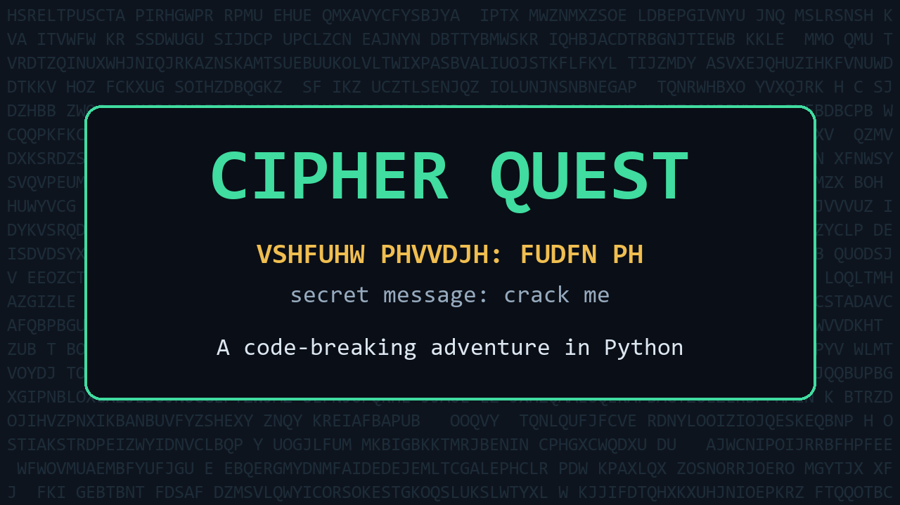

# Cipher Quest: A Code-Breaking Adventure



My final project for **Stanford Code in Place**: a console game where you crack secret messages.

## About

You're a new recruit at the Secret Message Society. Each of the five levels hands you an
intercepted message scrambled with a classic cipher:

| Level | Cipher | How it works |
|-------|--------|--------------|
| 1 | Mirror Writing | The whole message is written backwards |
| 2 | Caesar's Little Step | Every letter moves forward 1–3 places |
| 3 | Looking-Glass Alphabet | Atbash: a ↔ z, b ↔ y, c ↔ x … |
| 4 | Caesar's Giant Leap | A Caesar shift of 4–25 places |
| 5 | The Double Lock | A Caesar shift **and** each word reversed |

Each level is worth up to 100 points. A wrong guess costs 10 and a hint costs 25. Your final
score earns you a rank, from *Apprentice Decoder* up to *Grandmaster Codebreaker*. The messages
and shifts are random, so every game is different.

The **Cipher Workshop** lets you encode your own secret messages and brute-force crack any
Caesar cipher by trying all 25 shifts at once.

## How to run

You need Python 3. Nothing else needs installing.

```
python main.py
```

## What I used from Code in Place

- Functions and constants
- `for` and `while` loops
- String processing and the `%` operator (to wrap letters from z back to a)
- Lists and dictionaries
- The `random` module
- Checking user input so the game never crashes
